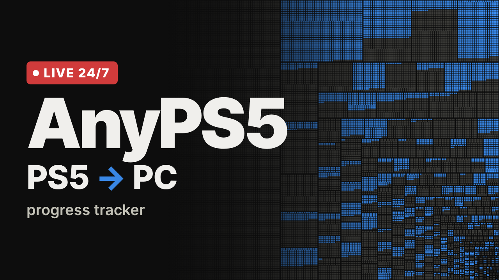

# AnyPS5 Live

A 24/7 YouTube live stream that shows the progress of [AnyPS5](https://github.com/boykopovar/AnyPS5) as a monitoring screen. Everything runs in Docker on a VPS: one container collects the data and serves a 1920×1080 dashboard, the other renders it in a headless browser and streams it to YouTube.



An unofficial community project: it is not affiliated with the AnyPS5 maintainers or with Sony, and it only reads AnyPS5's public data.

## What is on screen

- **Key figures**: system libraries implemented (percentage, functions done / declared, gains over 24 hours and 7 days), PRs merged today and this week, open PRs, playable games, GitHub stars and the latest release.
- **System libraries map**: the same squarified treemap as the progress map in AnyPS5's README, redrawn live: one block per library sized by its function count, filled with one cell per function, implemented ones first.
- **Latest merged PRs**: author, age, and the number of functions each PR implemented (green) or declared as stubs (grey), read from the project's progress-report bot.
- **Functions over time**: implemented and declared functions since the project started publishing its history.
- **Major changes**: new libraries, exports discovered, big daily jumps, completion-rate shifts (with the reason when the total widened), milestones, completed libraries, new releases.
- **Games by stage**: the AnyPS5 roadmap's tracked games from "Converts" to "Playable".
- A UTC clock in the corner.

## How it works

```
                 ┌──────────────────────────────┐        ┌──────────────────────────────────┐
 GitHub API ───► │ dashboard (Node 22)          │  HTTP  │ streamer                         │  RTMP
 Pages JSON ───► │ collects, detects events,    │ ─────► │ Xvfb + Chromium (kiosk 1920×1080)│ ─────► YouTube
 Roadmap   ────► │ serves / and /api/state      │        │ ffmpeg x11grab → H.264 + AAC     │
                 │ volume: daily snapshots      │        │ restarts itself on failure       │
                 └──────────────────────────────┘        └──────────────────────────────────┘
```

| Data | Source | Refresh (with token / without) |
|---|---|---|
| Progress, per-library counts | `https://boykopovar.github.io/AnyPS5/progress.json` | 10 / 15 min |
| History | `https://boykopovar.github.io/AnyPS5/history.json` | 30 min |
| Merged PRs and their progress reports | GitHub REST API | 2 / 6 min |
| Open PRs, merges per period | GitHub search API | 5 / 10 min |
| Stars, latest release | GitHub REST API | 10 / 30 min |
| Games by stage | `https://alxcbtw.github.io/anyps5-roadmap/` (`roadmap.json`, `feed.json`) | 3 h / 30 min |

The dashboard keeps one snapshot of every library per day in the `dashboard-data` volume. Comparing snapshots is what finds new libraries, newly discovered exports and completed libraries as they happen. History-based events (export waves, big jumps, milestones) are there from the first minute.

The browser page refreshes its data every 15 seconds and reloads itself every 6 hours; Chromium is restarted every 24 hours to keep memory flat.

## Requirements

- A VPS with Docker Engine and the Compose plugin.
- About 2.5 vCPU and 2 GB of RAM for the default 1440p at 30 fps (`PRESET=superfast`).
- Outbound TCP 1935 (RTMP) and about 13 Mbit/s of upload.

## Set up

1. **YouTube**: in YouTube Studio, choose *Create → Go live → Stream*. Copy the stream key. For a 24/7 stream, turn on *Auto-start*, turn off *Auto-stop*, keep latency on *Normal* and enable DVR. A channel that has never streamed may need to be verified and wait up to 24 hours before live streaming is enabled.
2. **GitHub token** (optional, recommended): create a fine-grained token at <https://github.com/settings/personal-access-tokens/new> with *Public repositories (read-only)* access and no permissions. Without it the dashboard still works, but stays within 60 API requests per hour.
3. **Deploy**:

   ```bash
   git clone <this repository> anyps5-live && cd anyps5-live
   cp .env.example .env
   nano .env            # YOUTUBE_STREAM_KEY, GITHUB_TOKEN
   docker compose up -d --build
   docker compose logs -f streamer
   ```

   The streamer waits for the dashboard's health check, starts the browser, then begins streaming. YouTube shows the preview within a minute.

### Single container

Some platforms build one Dockerfile and run one service (Coolify, Dokku, a self-hosted hub that deploys a GitHub repository on every push). For those, the `Dockerfile` at the root of the repository builds an image that runs the dashboard and the streamer together:

- Dockerfile: `Dockerfile`, build context: the repository root.
- Environment: `YOUTUBE_STREAM_KEY`, and optionally `GITHUB_TOKEN` and the encoder settings below. Without a stream key, the container only serves the dashboard.
- Port: the dashboard listens on `3000` (change it with `PORT`). Expose it only if you want to see the screen in a browser; the stream does not need it.
- Persistent data: mount a volume on `/data` to keep the daily snapshots across redeploys.

```bash
docker build -t anyps5-live .
docker run -d --restart unless-stopped -e YOUTUBE_STREAM_KEY=... -v anyps5-data:/data anyps5-live
```

## Preview and test without going live

- **See the dashboard** from your computer through an SSH tunnel:

  ```bash
  ssh -L 8080:127.0.0.1:8080 user@your-vps
  ```

  Then open <http://localhost:8080> in a window sized 1920×1080.

- **Record 30 seconds to a file** instead of streaming:

  ```bash
  docker compose run --rm -e OUTPUT=/recordings/test.mp4 -e RECORD_SECONDS=30 streamer
  ```

  The file appears in `./recordings/test.mp4`.

## Operate

| Task | Command |
|---|---|
| Logs | `docker compose logs -f dashboard streamer` |
| Update after a change | `git pull && docker compose up -d --build` |
| Restart the stream only | `docker compose restart streamer` |
| Stop everything | `docker compose down` (the snapshots stay in the volume) |
| Current state as JSON | `curl -s http://127.0.0.1:8080/api/state` |

**Soundtrack**: YouTube requires an audio track, so the streamer sends silence by default. Put `.mp3`, `.m4a`, `.ogg`, `.flac` or `.wav` files in `./music` to loop them instead; use only music you have the rights to stream.

## Thumbnail

`thumbnail.png` (1280×720) is ready to upload as the stream's thumbnail. To regenerate it with the current library map while the dashboard runs:

```bash
docker compose run --rm --entrypoint chromium streamer --headless=new --no-sandbox --disable-gpu   --hide-scrollbars --window-size=1280,720 --virtual-time-budget=20000   --screenshot=/recordings/thumbnail.png http://dashboard:8080/thumbnail.html
```

## Configuration

| Variable | Default | Purpose |
|---|---|---|
| `YOUTUBE_STREAM_KEY` | | YouTube stream key |
| `YOUTUBE_RTMP_URL` | `rtmp://a.rtmp.youtube.com/live2` | Ingest server (use `rtmp://b.rtmp.youtube.com/live2?backup=1` as a backup) |
| `OUTPUT` | | Overrides the destination: another RTMP URL or a file path |
| `RECORD_SECONDS` | | Stop after this many seconds (for tests) |
| `GITHUB_TOKEN` | | Read-only GitHub token |
| `WIDTH` / `HEIGHT` | `2560` / `1440` | Output resolution. The 1920×1080 page is rendered at this size rather than scaled up, so it stays sharp |
| `FPS` / `CAPTURE_FPS` | `30` / `10` | Output and capture frame rates. YouTube needs a steady 30 fps at a constant bitrate; the mostly static screen is captured at 10 fps and each frame repeated, which skips the colour conversion of the repeats |
| `VIDEO_BITRATE` / `BUFSIZE` / `PRESET` | `12000k` / `24000k` / `superfast` | Encoder settings, constant bitrate |
| `PORT` | `8080` (`3000` in the single-container image) | Dashboard port |
| `ANYPS5_REPO` | `boykopovar/AnyPS5` | Repository to follow (dashboard) |
| `ANYPS5_PAGES` | `https://boykopovar.github.io/AnyPS5` | Where `progress.json` and `history.json` are published |
| `ROADMAP_URL` | `https://alxcbtw.github.io/anyps5-roadmap` | Game roadmap |

## Troubleshooting

- **YouTube says "No data"**: check the stream key, that outbound port 1935 is open, and `docker compose logs streamer` for ffmpeg errors.
- **Black or frozen picture**: `docker compose exec streamer cat /tmp/chromium.log`. The compose file gives the streamer 1 GB of shared memory, which Chromium needs.
- **Blurry on YouTube**: YouTube re-encodes every stream. From a 1080p input it serves low-bitrate H.264, which smears the library map's thousands of cells; from 1440p it serves sharper VP9 encodes at every quality, 1080p included. Keep the default 1440p, and keep the stream latency on *Normal*.
- **High CPU**: the encoder works on every output frame, repeated or not. Use `PRESET=ultrafast`, or stream 1080p (`WIDTH=1920 HEIGHT=1080 VIDEO_BITRATE=6000k`).
- **YouTube: "not receiving enough video"**: keep `FPS=30` and the constant bitrate; YouTube's ingest does not accept a very low frame rate or a mostly empty bitrate.
- **Panels show "—"**: a source is slow or rate-limited. `curl -s http://127.0.0.1:8080/api/state` lists every source with its last success and error under `sources`. Add a `GITHUB_TOKEN`, or wait for the next refresh; the last good data stays on screen.

## Develop locally

```bash
cd dashboard
npm install
npm run dev          # http://localhost:8080, data kept in dashboard/data
```

## License

[MIT](LICENSE)
